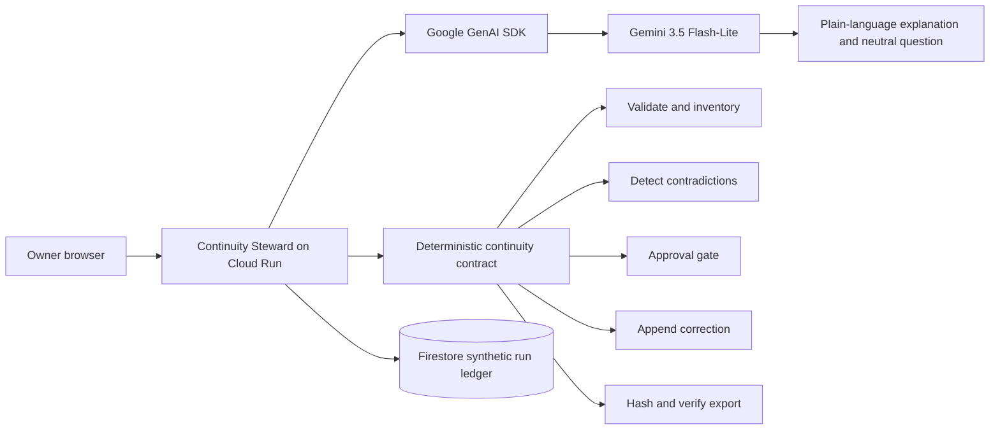

# Architecture Baseline

## Components



## Agent Workflow

```text
INGEST -> INVENTORY -> CLASSIFY -> DETECT -> CLARIFY
       -> PROPOSE -> APPROVE -> APPLY -> EXPORT -> VERIFY
```

## Responsibility Split

- Gemini explains ambiguity and drafts one focused neutral question.
- Deterministic tools validate schemas, hashes, authority, append-only relations, and export integrity.
- Firestore stores synthetic state and receipts.
- Cloud Run hosts the application and agent workflow.
- The browser console presents decisions and evidence to the owner.

## Failure Behavior

- Invalid input fails before persistence.
- Insufficient evidence produces a clarification request, not an invented answer.
- Missing approval blocks mutation.
- Export verification failure prevents a success receipt.
- Cloud or model failure preserves the last confirmed state.

## Cost Boundary

- Scale Cloud Run to zero when idle.
- Use Gemini Flash by default.
- Enforce per-run model and storage budgets.
- Seed deterministic synthetic fixtures for repeatable demonstrations.
- Keep the judging environment inexpensive enough to remain available through the judging period.

## Public Demo Boundary

- The public API loads only the built-in fictional Aster fixture.
- It does not accept arbitrary uploads, companion profiles, or private memory.
- Cloud Run authenticates to Vertex AI through its service identity; the baseline deployment has no application API key.
- The first bounded explanation is cached against the exact fictional finding to prevent repeat model spending.
- Cloud Run maximum instances should remain one during judging.
- A model outage leaves the last confirmed Firestore state intact and returns a safe stop message.
